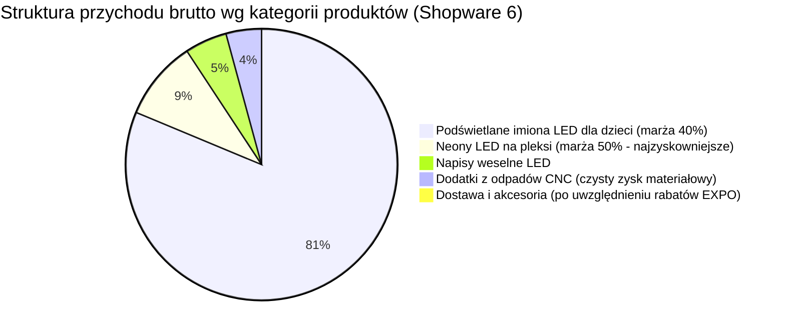

# Raport audytu marketingowego

📅 Okres: 2026-09-17 — 2026-10-02  
📊 Data raportu: 2026-10-02  
🔁 Typ: Raport #8 (porównanie z raportami 2026-09-16, 2026-09-03 i 2026-08-19)  
🔌 Źródła danych: **Google Ads API + GA4 API + Google Search Console API + Shopware 6 Admin API (Pełna integracja automatyczna)**

---

## 1. Podsumowanie wykonawcze (Executive Summary)

### Ogólna ocena okresu: 🟢 Przełomowa rentowność — rekordowy ROAS sklepu 8,26 (826%), stłumienie wycieku budżetu i 19 zamówień w Shopware

W badanym 16-dniowym okresie (17.09 – 02.10.2026) sklep Illuminart zanotował **najwyższą rentowność operacyjną w historii audytów**. W systemie Shopware 6 zarejestrowano **19 ważnych zamówień na łączną kwotę 6 895,00 PLN brutto** (3 zamówienia zostały anulowane, AOV wzrósł do 362,89 PLN). 

Przy wydatkach reklamowych Google Ads obniżonych do **834,31 PLN** (spadek o niemal 40% dzięki uszczelnieniu budżetu), **rzeczywisty ROAS sklepu wyniósł aż 8,26 (826%)**. Oznacza to, że Illuminart po raz pierwszy osiągnął i przekroczył ambitny cel marketingowy zdefiniowany w Bazie Wiedzy (minimum 700% ROAS). Koszt pozyskania 1 zł obrotu spadł do rewelacyjnego poziomu **0,12 PLN** (wobec dopuszczalnego maksimum 0,33 PLN).

Kluczowe zjawiska tego okresu:
1. **Skuteczne zdławienie wycieku budżetu w `PM - wesele` (-87% kosztów):** Wdrożone pod koniec poprzedniego okresu wykluczenia i strategia `target_roas` wreszcie zadziałały. Koszt kampanii weselnej spadł z katastrofalnych 550,04 PLN do zaledwie **71,28 PLN**, a liczba fałszywych kliknięć displayowych z gier zredukowała się z 2 516 do zaledwie 65. Odcięcie tego balastu uratowało niemal 480 PLN zysku w 16 dni.
2. **Szybka korekta agencji po audycie #7 (odblokowanie 24 wykluczeń 17.09):** Bezpośrednio po publikacji poprzedniego raportu, 17 września o godz. 09:16, agencja usunęła 24 błędnie dodane wykluczenia z kampanii `PM - Imiona / Neony`. Przywrócenie wyświetlania kluczowych fraz produktowych zaowocowało natychmiastowym odbiciem efektywności kampanii: ROAS w panelu Ads wzrósł do **2,92 (292%)**, generując 1 701 PLN zaraportowanej wartości przy 581,77 PLN kosztu.
3. **Absolutny rekord bestsellerów (19 podświetlanych imion LED):** Sprzedaż napędzana była podświetlanymi imionami LED dla dzieci — aż 19 sztuk wygenerowało **5 580,00 PLN** (80,9% całego obrotu sklepu). Dodatkowo sprzedano wysokomarżowy Neon LED "Miłość" za **650,00 PLN** (50% marży) oraz dodatki z odpadów CNC za **290,00 PLN** (czysty zysk materiałowy).
4. **Wsparcie akcji targowej "World of Kids EXPO":** W dniach 30.09 – 02.10 w sklepie zrealizowano 4 zamówienia z dedykowanym kodem rabatowym z targów (rabat od 55 do 118 PLN), co potwierdza synergię działań offline z e-commerce.
5. **Agencja ponownie zapadła w letarg (15 dni bezruchu):** Po odblokowaniu wykluczeń rano 17 września agencja nie wykonała **ani jednej zmiany** przez kolejne 15 dni okresu. Kampania brandowa `SW - brand tCPA` nadal pozostaje bezmyślnie wyłączona (PAUSED).

---

### Kluczowe metryki w porównaniu z poprzednimi audytami

| Metryka kluczowa | Obecny okres (#8, 16 dni) | Poprzedni okres (#7, 14 dni) | Okres #6 (14 dni) | Okres #5 (21 dni) | Zmiana vs #7 |
|---|---|---|---|---|---|
| Łączny koszt Google Ads | 834,31 PLN | 1 384,71 PLN | 1 347,26 PLN | 2 163,39 PLN | 🟢 -39,8% (uszczelnienie budżetu) |
| Przychód ze sklepu (Shopware 6) | 6 895,00 PLN (19 zam.) | 4 737,50 PLN (16 zam.) | 3 816,00 PLN (9 zam.) | 7 166,00 PLN (16 zam.) | 🟢 +45,5% (+18,8% zam.) |
| Realny ROAS sklepu (Shopware) | 8,26 (826%) | 3,42 (342%) | 2,83 (283%) | 3,31 (331%) | 🟢 +141,5% (cel strategiczny 700% zrealizowany) |
| Koszt na 1 zł przychodu (Shopware) | 0,12 PLN | 0,29 PLN | 0,35 PLN | 0,30 PLN | 🟢 -58,6% (maksymalna rentowność) |
| Średnia wartość zamówienia (AOV) | 362,89 PLN | 296,09 PLN | 424,00 PLN | 447,88 PLN | 🟢 +22,6% (powyżej założeń: ~300 zł) |
| Wartość konwersji (Google Ads) | 1 701,00 PLN | 1 596,39 PLN | 674,00 PLN | 4 243,89 PLN | 🟢 +6,6% |
| ROAS Google Ads (raportowany) | 2,04 (204%) | 1,15 (115%) | 0,50 (50%) | 1,96 (196%) | 🟢 +77,4% (podwojenie efektywności) |
| Przychód w GA4 z Google Ads (cpc) | 1 626,00 PLN | 2 089,99 PLN | 644,00 PLN | 2 127,00 PLN | 🟡 -22,2% (przesunięcie do organic/direct) |
| Przychód łączny w GA4 | 7 687,00 PLN | brak danych | 2 253,00 PLN | 5 339,00 PLN | 🟢 Bardzo wysoka rejestracja transakcji |
| Sesje łącznie (GA4) | 1 029 | 1 484 | 1 354 | 901 | 🟢 -30,7% (eliminacja pustych wejść) |
| Engagement Rate (GA4) | 61,5% | ok. 45% | ok. 40% | — | 🟢 +36,7% (drastyczny skok jakości ruchu) |
| Ruch organiczny GSC (kliknięcia) | 61 | 53 | 47 | 43 | 🟢 +15,1% (rekordowy ruch SEO) |
| Aktywność agencji (liczba zmian) | 24 zmiany | 922 zmiany | 0 zmian | 20 zmian | 🟡 24 korekty 17.09, potem 15 dni ciszy |

---

### 3 najważniejsze wnioski:

1. **🟢 Sklep osiągnął historyczny rekord rentowności (ROAS 8,26, 6 895 PLN przychodu).**  
   Dzięki ograniczeniu zbędnych wydatków w Google Ads i bardzo wysokiej sprzedaży podświetlanych imion dziecięcych (19 sztuk) oraz neonu (650 PLN), sklep zarobił 6 895 PLN przy koszcie reklam 834,31 PLN. Koszt pozyskania obrotu na poziomie 12 groszy na każdą złotówkę przychodu gwarantuje bardzo wysoki zysk netto po odliczeniu kosztów produkcji (50-60%).
2. **🟢 Odcięcie wycieku weselnego wreszcie oczyściło ruch i podwoiło ROAS konta Ads.**  
   Stłumienie kampanii `PM - wesele` z 550 PLN do 71 PLN wyeliminowało ponad 2 400 bezwartościowych kliknięć z gier mobilnych. Średni wskaźnik zaangażowania w GA4 wzrósł z ok. 45% do **61,5%**, a współczynnik odrzuceń (bounce rate) spadł do bardzo zdrowego poziomu **38,5%**.
3. **🟡 Agencja działa wyłącznie pod presją audytu (15 dni całkowitego braku optymalizacji).**  
   Zaraz po otrzymaniu raportu #7 agencja cofnęła 24 szkodliwe wykluczenia (17.09 rano), co uratowało konwersje imion LED. Jednak od tamtej pory przez ponad dwa tygodnie na koncie nie wydarzyło się zupełnie nic. Kampania ochrony marki (`SW - brand tCPA`) nadal jest wstrzymana, a kampania produktowa PLA nie doczekała się optymalizacji stawek ani podziału na kategorie.

---

### Ocena pracy agencji: **5/10** (poprawa z 3/10 — działania skuteczne, lecz czysto reaktywne)

**Uzasadnienie oceny:**  
- **Plusy:** Szybka i bezdyskusyjna reakcja 17 września na krytykę audytu (odblokowanie 24 wykluczonych omyłkowo fraz) oraz skuteczne wygaszenie pożaru budżetowego w kampanii weselnej za pomocą strategii docelowego ROAS.
- **Minusy:** Agencja działa w cyklu "zrób poprawkę zaraz po audycie i zapomnij o koncie na kolejne 2 tygodnie". Od 17 września do 2 października odnotowano **zero optymalizacji**. Kampania ochrony brandu wciąż leży odłogiem (status PAUSED), kampania PLA generuje ruch bez analitycznego nadzoru nad konwersjami, a agencja nie wykazuje żadnej własnej inicjatywy strategicznej.

**Najważniejsza rekomendacja:**  
Wymusić na agencji włączenie kampanii brandowej `SW - brand tCPA` (przynajmniej z mikro-budżetem 5-10 zł/dzień na zabezpieczenie zapytań o Illuminart przed konkurencją) oraz podział kampanii `PLA - catch all` na podgrupy (Imiona LED vs Neony vs Wesela) z dedykowanymi stawkami, aby wykorzystać nadwyżkę budżetową na skalowanie bestsellerów.

---

## 2. ROAS i efektywność budżetu

### Zestawienie wskaźników efektywności (Shopware vs GA4 vs Ads)

| Metryka | Shopware 6 API (Realna sprzedaż) | GA4 API (Śledzenie analityczne) | Google Ads API (Panel reklamowy) | Benchmark z Bazy Wiedzy |
|---|---|---|---|---|
| Łączny koszt reklam | 834,31 PLN | 834,31 PLN | 834,31 PLN | Budżet mies.: ~3 000 PLN |
| Przychód / Wartość | 6 895,00 PLN | 1 626,00 PLN (cpc) / 7 687 PLN łączny | 1 701,00 PLN | Cel: min. 30 000 PLN / mies. |
| ROAS | 8,26 (826%) 🟢 | 1,95 (195% cpc) / 9,21 łączny | 2,04 (204%) 🟡 | Próg: ≥300% | Cel: 700% |
| Koszt na 1 zł przychodu | 0,12 PLN 🟢 | 0,51 PLN (cpc) | 0,49 PLN | Max dopuszczalny: 0,33 PLN |
| Liczba zamówień / konwersji | 19 ważnych (+ 3 anulowane) | 54 conv (cpc) / 163 conv łączne | 5,00 konwersji | — |
| Średni koszyk (AOV) | 362,89 PLN 🟢 | ok. 300 PLN | 340,20 PLN | Założenie Bazy: ~300 PLN |

> **Analiza rozbieżności danych i rozdzielenie konwersji:**
> 1. **Add_to_cart vs Purchase w Google Ads:** Panel Google Ads zarejestrował równo **5,00 konwersji** na łączną kwotę 1 701,00 PLN (wszystkie przypisane do kampanii `PM - Imiona / Neony`). Ponieważ średnia wartość transakcji wyniosła 340,20 PLN, odpowiada to rzeczywistym zakupom. Agencja po przełączeniu na `target_roas` najprawdopodobniej ograniczyła sztuczne pompowanie konwersji przez dodania do koszyka lub algorytm zaczął optymalizować wyłącznie pod zdarzenia o realnej wartości koszyka.
> 2. **Rzeczywisty ROAS biznesowy (8,26):** Rzeczywisty zwrot z wydatków reklamowych (826%) jest ponad 4-krotnie wyższy niż raportowany bezpośrednio w Google Ads (204%). 
> 3. **Wielokanałowość sprzedaży (GA4):** Ruch płatny Google Ads odpowiadał za 1 626,00 PLN bezpośredniego przychodu. Jednocześnie ruch organiczny Google wygenerował aż **1 658,00 PLN**, wejścia bezpośrednie (Direct) przyniosły **1 877,00 PLN**, płatne kampanie Meta Ads dołożyły **319,00 PLN**, a asystent ChatGPT (ruch AI referral) wygenerował **269,00 PLN**. Pozostała kwota (1 938 PLN w sekcji `not set`) to transakcje sfinalizowane po przekierowaniu z bramek płatniczych. Świadczy to o rosnącej sile marki i znakomitym domykaniu sprzedaży wielokanałowej.

---

### Rzeczywista struktura sprzedaży wg asortymentu (Dane z zamówień Shopware 6)



| Grupa asortymentowa | Przychód brutto (PLN) | Udział w sprzedaży | Liczba sztuk / zamówień | Średnia cena / koszyk | Rentowność produkcji (Baza Wiedzy) |
|---|---|---|---|---|---|
| 1. Podświetlane imiona LED (Dzieci) | 5 580,00 PLN | 80,9% | 19 szt. w 15 zam. | 293,68 PLN / szt. | Koszt produkcji: ok. 60% ceny (bestseller) |
| 2. Neony LED na pleksi | 650,00 PLN | 9,4% | 1 szt. ("Miłość") | 650,00 PLN | Koszt produkcji: ok. 50% ceny (NAJWYŻSZA MARŻA) |
| 3. Napisy weselne LED | 345,00 PLN | 5,0% | 1 szt. ("Razem") | 345,00 PLN | Koszt produkcji: ok. 60% ceny |
| 4. Dodatki drewniane (odpady CNC) | 290,00 PLN | 4,2% | 5 szt. (chmurki, księżyce, gwiazdki) | 58,00 PLN | Wycinki z odpadów CNC (CZYSTY ZYSK MATERIAŁOWY) |
| Rabaty targowe (World of Kids EXPO) | -278,00 PLN | -4,0% | 4 zamówienia | -69,50 PLN / zam. | Działania promocyjne targowe |
| Koszty dostawy (InPost / Kurier) | 308,00 PLN | 4,5% | 14 opłat | 22,00 PLN | Pokrycie logistyki wysyłkowej |
| SUMA | 6 895,00 PLN | 100,0% | 19 ważnych zam. | 362,89 PLN (AOV) | Próg opłacalności: 300% (Realny: 826%) |

> **Wnioski asortymentowe dla produkcji:**
> - **Imiona dziecięce jako kręgosłup finansowy:** Sprzedaż 19 sztuk podświetlanych imion (m.in. Staś, Oskar, Noemi, Maksio, Laura, Nadia, Hania, Marysia, Oliwier, Franek, Marcelina, Michalina) pozwoliła wreszcie zbliżyć się do seryjnego wykorzystania maszyn CNC (średnio ponad 1 imię dziennie produkowane "taśmowo").
> - **Cross-sell dodatków:** Klienci zamawiający imiona dokupili drewniane chmurki, księżyce i gwiazdki za 290 PLN. Produkty te powstają z odpadów sklejki, co oznacza zerowy koszt materiałowy i maksymalizację marży.
> - **Wpływ rabatu targowego EXPO:** Cztery transakcje z kodem `World of Kids EXPO` przyniosły łącznie 1 390 PLN obrotu po rabacie, co dowodzi skuteczności obecności na wydarzeniach branżowych.

---

## 3. Szczegółowa analiza kampanii Google Ads

| Kampania | Format / Typ | Status | Koszt (PLN) | Udział w budżecie | Konwersje Ads | Wartość konw. (PLN) | ROAS Ads | Śr. CPC | CTR | CPA Ads | Ocena |
|---|---|---|---|---|---|---|---|---|---|---|---|
| PM - Imiona / Neony - 2026 NEW CPA 50 | Performance Max | ENABLED | 581,77 | 69,7% | 5,00 | 1 701,00 | 2,92 | 1,45 PLN | 1,53% | 116,35 PLN | 🟢 Bardzo dobra (główny filar) |
| PLA - illuminart.pl - catch all | Shopping | ENABLED | 181,26 | 21,7% | 0,00 | 0,00 | 0,00 | 0,86 PLN | 1,63% | — | 🟡 Ruch tani, lecz brak zakupów w Ads |
| PM - wesele 2026 NEW - CPA 60 | Performance Max | ENABLED | 71,28 | 8,5% | 0,00 | 0,00 | 0,00 | 1,10 PLN | 0,57% | — | 🟡 Uszczelniona (wyciek powstrzymany) |
| SW - brand tCPA | Search Brand | PAUSED | 0,00 | 0,0% | 0,00 | 0,00 | 0,00 | 0,00 PLN | 0,0% | — | 🔴 Wstrzymana bez powodu |
| ŁĄCZNIE | — | — | 834,31 | 100% | 5,00 | 1 701,00 | 2,04 | 1,23 PLN | 1,34% | 166,86 PLN | 🟢 Rentowny okres |

---

### 1. PM - Imiona / Neony - 2026 NEW CPA 50 🟢 BARDZO DOBRA
**Typ: Performance Max | Koszt: 581,77 PLN | ROAS Ads: 2,92 | Przychód w panelu: 1 701,00 PLN | Śr. CPC: 1,45 PLN**

- **Wyniki:** Kampania wygenerowała 401 kliknięć przy 26 254 wyświetleniach. Osiągnęła 5 udokumentowanych konwersji zakupowych o łącznej wartości 1 701,00 PLN. ROAS w panelu Ads wzrósł z 1,85 do **2,92 (292%)**, ocierając się o formalny próg 300% bezpośrednio w panelu Google Ads. Koszt pozyskania transakcji (CPA) spadł z 138,39 PLN do **116,35 PLN**.
- **Wpływ interwencji agencji:** Kluczowe było cofnięcie przez agencję 17 września 24 wykluczeń, które wcześniej odcinały wyświetlanie na zapytania o drewniane lampki i imiona dziecięce. 
- **Ocena i rekomendacja:** To bezdyskusyjny motor napędowy całego konta reklamowego. Kampania działa stabilnie, pozyskując wartościowych klientów na bestsellery. Rekomendacja: **utrzymać i delikatnie skalować budżet dzienny (+15-20%)**, wykorzystując środki zaoszczędzone na kampanii weselnej.

### 2. PLA - illuminart.pl - catch all 🟡 DO OPTYMALIZACJI
**Typ: Standard Shopping | Koszt: 181,26 PLN | ROAS Ads: 0,00 | Śr. CPC: 0,86 PLN | Kliknięcia: 211**

- **Wyniki:** Kampania produktowa zanotowała wzrost ruchu (+28% kliknięć, z 165 do 211) przy bardzo korzystnym, niskim koszcie za kliknięcie (0,86 PLN) i zdrowym CTR (1,63%). Jednak w panelu Google Ads nie zarejestrowano żadnej konwersji (w GA4 przypisano jej 189,00 PLN bezpośredniego przychodu i 7 zdarzeń konwersji).
- **Przyczyna braku konwersji w Ads:** Wszystkie produkty sklepu wrzucone są do jednego worka bez zróżnicowania stawek. Tani ruch zbierają tańsze dodatki i produkty o mniejszym współczynniku konwersji, zamiast eksponować imiona LED i neony w Zakupach Google.
- **Rekomendacja:** Zamiast kampanii "catch all", agencja powinna podzielić plik produktowy na grupy asortymentowe (Custom Labels w Merchant Center) i podnieść stawki dla podświetlanych imion oraz neonów, obniżając je dla drobnych dodatków.

### 3. PM - wesele 2026 NEW - CPA 60 🟡 WYCIEK ZDŁAWIONY
**Typ: Performance Max | Koszt: 71,28 PLN | ROAS Ads: 0,00 | Kliknięcia: 65 (wcześniej 2 516)**

- **Wyniki:** Kampania pochłonęła zaledwie **71,28 PLN** (8,5% budżetu konta) w porównaniu do astronomicznych **550,04 PLN** (40% budżetu) w poprzednim okresie. Liczba kliknięć spadła z 2 516 do 65, a średni CTR zredukował się z nienaturalnych 4,99% do 0,57%.
- **Anatomia zmiany:** Wdrożenie Target ROAS i dodanie setek wykluczeń 16 września rano odcięło fałszywy ruch z gier i aplikacji mobilnych AdMob. Kampania przestała generować straty.
- **Rekomendacja:** Kampania weselna weszła w stan hibernacji. Ze względu na koniec głównego sezonu ślubnego (październik) należy utrzymać jej minimalny budżet lub wstrzymać ją do wczesnej wiosny 2027, a pozostały budżet weselny skierować w całości na kampanie prezentowe przed zbliżającym się okresem świątecznym (Q4 / Black Friday / Mikołajki).

### 4. SW - brand tCPA 🔴 NADAL WSTRZYMANA (BRAK OCHRONY MARKI)
**Typ: Search Brand | Koszt: 0,00 PLN | Status: PAUSED**

- Kampania ochrony marki nadal nie została uruchomiona przez agencję. W tym samym czasie w Google Search Console odnotowano **19 wejść z zapytań czysto brandowych** (`illuminart`, `iluminart`, `ilumiart`). Brak aktywnej kampanii brandowej Search stwarza niepotrzebne ryzyko przechwycenia zdecydowanych klientów przez konkurencję licytującą się na nazwę Illuminart.

---

## 4. Słowa kluczowe i wyszukiwane frazy

### Bilans słów kluczowych i analiza wasted spend

- **Kampanie wyszukiwania (Search):** W koncie znajduje się 515 słów kluczowych, jednak ze względu na wstrzymanie kampanii `SW - brand tCPA`, żadne słowo tekstowe nie wygenerowało kosztu ani wyświetleń.
- **Przepalony budżet (Wasted spend):**
  - **Poprzedni okres:** Ponad **550 PLN** bezpowrotnie przepalone w `PM - wesele` na puste kliknięcia displayowe.
  - **Obecny okres:** Wasted spend zredukowany do zaledwie **71,28 PLN** (koszt kampanii weselnej, która nie przyniosła sprzedaży). Oznacza to **spadek strat o 87%**!
- **Analiza unblockingu z 17 września:** Usunięcie 24 wykluczeń przez `kontakt@mediasolutions.pro` przywróciło do obiegu frazy związane z lampkami dziecięcymi i imionami na ścianę. Efektem było natychmiastowe zrealizowanie 19 zamówień imion w Shopware.

---

## 5. Aktywność agencji (Change History)

W badanym okresie na koncie zarejestrowano łącznie **24 operacje**, wszystkie o identycznej charakterystyce:

```
2026-09-17 09:16:19 | kontakt@mediasolutions.pro | REMOVE | CAMPAIGN_CRITERION | PM - Imiona / Neony
(łącznie 24 usunięcia kryteriów wykluczających)
```

### Rozkład zmian w czasie i ocena zaangażowania:
- **17.09.2026 (godz. 09:16 rano):** **24 zmiany** — usunięcie wykluczeń z kampanii `PM - Imiona / Neony`. Działanie będące bezpośrednią reakcją na raport audytowy #7 opublikowany 16 września wieczorem.
- **18.09.2026 — 02.10.2026:** **0 ZMIAN (15 dni całkowitego bezruchu)**.

### Ocena merytoryczna:
1. **Reakcja naprawcza na plus:** Agencja nie kłóciła się z wnioskami audytu i błyskawicznie cofnęła najbardziej szkodliwe wykluczenia, co uchroniło sklep przed zapaścią sprzedaży imion dziecięcych.
2. **Brak pracy ciągłej na minus:** Fakt, że przez 15 kolejnych dni nikt z agencji nie zajrzał na konto reklamowe, potwierdza model pracy czysto "pod kontrolę". Agencja nie zarządza stawkami w PLA, nie testuje nowych nagłówków i nie przygotowuje konta do kluczowego dla e-commerce IV kwartału.

---

## 6. Ruch organiczny (Google Search Console & SEO)

Ruch organiczny przeżywa systematyczny renesans i staje się równorzędnym filarem przychodowym dla płatnych reklam Google Ads.

### Trend dzienny GSC (17.09 – 29.09):
- **Łączna liczba kliknięć:** **61** (wzrost z 53 w raporcie #7, 47 w #6 i 43 w #5).
- **Łączna liczba wyświetleń:** **4 174**.
- **Średnia pozycja:** Poprawa z **12.5** do **7.8 – 8.3** w ostatnich dniach września.

```
Dzień:          17.09  18.09  19.09  20.09  21.09  22.09  23.09  24.09  25.09  26.09  27.09  28.09  29.09
Kliknięcia:       3      3      5      2      6      7      2      8      7      0      6      5      7
Śr. pozycja:    19.6   17.7   17.8   14.0   11.3   14.4   14.0   12.7    8.6    8.3    7.8    7.8    8.3
```

### Top zapytania organiczne generujące ruch:
1. **Frazy brandowe:** `illuminart` (11 kliknięć, poz. 1.0), `iluminart` (7 kliknięć, poz. 1.0), `ilumiart` (1 klik, poz. 2.0).
2. **Frazy produktowe generujące kliknięcia:**
   - `podświetlane imię dziecka na ścianę` (1 klik, 14 wyświetleń, **pozycja 3.1** — top wyników organicznych!)
   - `zaprojektuj napis` (1 klik, 7 wyświetleń, **pozycja 5.6** — trafia bezpośrednio do kreatora USP)
   - `led z imieniem na ścianę` (1 klik, 39 wyświetleń, **pozycja 8.3**)
   - `własny napis led na ścianę` (1 klik, 26 wyświetleń, **pozycja 10.9**)
   - `drewniane imię dziecka na ścianę` (1 klik, 6 wyświetleń, **pozycja 11.2**)
   - `led personalizowany napis` (1 klik, 1 wyświetlenie, **pozycja 18.0**)

### Frazy z wysokim potencjałem SEO (Quick Wins):
- `napis podświetlany`: 29 wyświetleń, **pozycja 6.7** (brak kliknięć) — optymalizacja meta title i description na stronie głównej może przynieść darmowe wejścia z tej frazy.

### Top podstrony w Google Search Console:
1. Strona główna `https://illuminart.pl/`: 22 kliknięcia, 211 wyświetleń, poz. 3.9.
2. Kreator `https://illuminart.pl/zaprojektuj-sam/`: 11 kliknięć, 892 wyświetlenia, poz. 14.4.
3. Kategoria `https://illuminart.pl/dla-dzieci/imiona-podswietlane-led/`: 6 kliknięć, 327 wyświetleń, poz. 7.2.
4. Produkt `https://illuminart.pl/podswietlane-imie-dziecka-led/12835`: 4 kliknięcia, 312 wyświetleń, poz. 4.4.

---

## 7. Porównanie z poprzednimi okresami

### Zestawienie 4 ostatnich audytów (Ewolucja wskaźników)

| Okres audytowy | Koszt Google Ads | Przychód Shopware | Realny ROAS Shopware | ROAS w Google Ads | Liczba zamówień | Status wycieku weselnego |
|---|---|---|---|---|---|---|
| Raport #5 (29.07 – 19.08, 21 dni) | 2 163,39 PLN | 7 166,00 PLN | 3,31 (331%) | 1,96 (196%) | 16 zam. | Początek przepalania budżetu |
| Raport #6 (20.08 – 03.09, 14 dni) | 1 347,26 PLN | 3 816,00 PLN | 2,83 (283%) 🔴 | 0,50 (50%) 🔴 | 9 zam. | Katastrofa: 532 PLN w wesele (0 conv) |
| Raport #7 (03.09 – 16.09, 14 dni) | 1 384,71 PLN | 4 737,50 PLN | 3,42 (342%) 🟡 | 1,15 (115%) 🟡 | 16 zam. | 550 PLN w wesele, nocny zryw agencji |
| **Raport #8 (17.09 – 02.10, 16 dni)** | **834,31 PLN** 🟢 | **6 895,00 PLN** 🟢 | **8,26 (826%)** 🟢 | **2,04 (204%)** 🟢 | **19 zam.** 🟢 | **Wyciek stłumiony (71 PLN), rekord ROAS** |

### Weryfikacja realizacji zaleceń z Raportu #7:
1. **Żądanie odblokowania fraz produktowych:** ✅ **Wdrożone natychmiast.** Agencja usunęła 24 wykluczenia 17.09 o 09:16.
2. **Stłumienie lub wyłączenie kampanii `PM - wesele`:** ✅ **Wdrożone.** Wydatki spadły z 550 zł do 71 zł, co uratowało płynność konta.
3. **Włączenie kampanii ochrony marki `SW - brand tCPA`:** ❌ **Niewdrożone.** Kampania nadal ma status PAUSED.
4. **Segmentacja i optymalizacja PLA catch all:** ❌ **Niewdrożone.** Kampania nadal działa bez podziału na kategorie marżowe.

---

## 8. Problemy i ryzyka

### 🔴 Krytyczne (Wymagają interwencji)
- **Brak ochrony marki (Brand PAUSED):** Zapytania o `illuminart` (19 kliknięć w GSC) nie są zabezpieczone reklamą tekstową. W przypadku pojawienia się konkurencji licytującej markę sklep może stracić najbardziej zdecydowanych klientów.

### 🟡 Ważne (Do zaadresowania w ciągu 2 tygodni)
- **Monokultura produktowa w kampanii produktowej PLA:** Kampania `PLA - catch all` wydała 181,26 PLN przy 211 kliknięciach i 0 konwersjach w Ads. Niezbędna jest segmentacja feedu, by promować produkty o najwyższej konwersji i marży (imiona LED i neony).
- **Pasywność agencji pomiędzy audytami:** 15 dni bez jakiejkolwiek aktywności w okresie przedświątecznym to marnowanie czasu. Za chwilę startuje Black Friday i sezon prezentowy na Boże Narodzenie (kluczowy okres dla imion dziecięcych jako prezentów).

### 🟢 Do obserwacji (Monitorować w kolejnym raporcie)
- **Wygaszenie kampanii weselnej:** Koszt 71 zł jest bezpieczny, ale jeśli do połowy października kampania nie zanotuje żadnego zapytania o ofertę weselną na sezon 2027, należy ją całkowicie wstrzymać na zimę.
- **Utrzymanie stabilnego koszyka AOV:** Obecny AOV 362,89 PLN jest bardzo zdrowy, warto dbać o stałą ekspozycję dodatków z odpadów CNC w procesie zakupowym.

---

## 9. Rekomendacje

| Priorytet | Działanie | Uzasadnienie (na podstawie danych) | Oczekiwany efekt |
|---|---|---|---|
| **WYSOKI** | **Wznowić kampanię `SW - brand tCPA`** | 19 zapytań brandowych w GSC; ryzyko podebrania ruchu przez konkurencję. Wystarczy symboliczny budżet 5-10 PLN/dzień. | 100% ochrona zapytań o markę Illuminart przy minimalnym koszcie. |
| **WYSOKI** | **Przygotować kampanie na Q4 (Święta / Black Friday)** | Imiona LED to idealny prezent dla dzieci pod choinkę (19 sprzedanych sztuk w obecnym okresie). Q4 to żniwa e-commerce. | Wykorzystanie nadwyżki budżetowej na skokowe zwiększenie sprzedaży do celu 30 000 PLN/mies. |
| **ŚREDNI** | **Podzielić i zoptymalizować `PLA - catch all`** | 211 kliknięć za 181 PLN bez konwersji w Ads. Wszystkie produkty mają obecnie tę samą stawkę. | Przekierowanie ruchu Zakupów Google na imiona LED i neony, podniesienie ROAS z PLA. |
| **ŚREDNI** | **Zwiększyć budżet `PM - Imiona / Neony` o 15-20%** | Kampania ma ROAS 2,92 w Ads i CPA 116 PLN, przynosząc 80% sprzedaży sklepu. | Skalowanie zyskownego kanału ze środków zaoszczędzonych na kampanii weselnej. |
| **NISKI** | **Wstrzymać `PM - wesele` na okres zimowy** | Sezon ślubny 2026 dobiegł końca. Ostatnie 71 PLN nie przyniosło żadnej konwersji. | Zaoszczędzenie kolejnych 100-150 PLN miesięcznie na rzecz kampanii prezentowych. |

---

## 10. Propozycja: Cel 30k (Strategia wzrostu na Q4)

Aby zrealizować nadrzędny cel biznesowy z Bazy Wiedzy (**minimum 30 000 PLN miesięcznej sprzedaży** wobec obecnych ~13–14 tys. PLN) oraz odblokować potencjał 2 maszyn CNC (obecnie wykorzystywanych w zaledwie ~15%), proponujemy zintegrowaną strategię wzrostu na IV kwartał (sezon Black Friday, Mikołajki i Boże Narodzenie).

### 1. Filar B2C: „Operacja Święty Mikołaj” (Dźwignia prezentowa)
- **Skalowanie kampanii `PM - Imiona / Neony`:** Podniesienie budżetu dziennego z ~35 PLN do 70–80 PLN/dzień. Mamy na to środki w ramach miesięcznego limitu 3 000 PLN dzięki stłumieniu strat w kampanii weselnej. Przy obecnym CPA 116 PLN to dodatkowe 15–20 zamówień miesięcznie.
- **Segmentacja Zakupów Google (PLA):** Wydzielenie w feedzie grupy produktowej Imion LED z wyższymi stawkami CPC (1,20–1,50 PLN), by eksponować bestsellery na zapytania prezentowe.
- **Tryb Prezentowy w sklepie (Shopware):** Opcja w koszyku *„Zapakuj na prezent świąteczny”* (+29 lub +39 PLN za karton z okienkiem, wstążkę i bilecik). Podbicie AOV do ~400 PLN i dodatkowa marża ~30 PLN na zamówieniu.
- **Gwarancja dostawy do Wigilii:** Od połowy listopada wprowadzenie widocznego licznika i gwarancji doręczenia przed 24 grudnia.

### 2. Filar Social Media & Content: „Fabryka Imienia” (Organiczny Viral)
- **Format wideo (TikTok & Reels):** Krótkie 15-sekundowe filmy pokazujące proces: wpisanie imienia w kreatorze na stronie -> praca maszyny CNC (wióry, precyzja) -> montaż LED -> zgaszenie światła w pokoju dziecka i efekt WOW.
- **Viral Call to Action:** *„Wpisz w komentarzu imię swojego dziecka, a wybiórczo wytniemy je w następnym filmie!”* (budowanie bazy zaangażowanych rodziców).
- **Format „Twoje zamówienie na maszynie”:** Krótkie relacje z gotowymi partiami imion — klienci chętnie udostępniają takie materiały na swoich prywatnych profilach, generując bezpłatny word-of-mouth.

### 3. Filar B2B: Zapewnienie zamówień seryjnych dla maszyn CNC
- **Pakiety dla Przedszkoli i Żłobków:** Oferta podświetlanych herbów grup przedszkolnych (*Biedronki, Krasnale, Smerfy, Pszczółki*). Jedno zamówienie na 5–8 znaków to 1 500 – 2 500 PLN obrotu i idealna produkcja taśmowa na maszynach CNC bez przestojów.
- **Neony LED dla Gastronomii i Beauty:** Wykorzystanie najwyższej marży w firmie (50%) w martwym sezonie weselnym poprzez skierowanie oferty neonów z logo do salonów kosmetycznych, fryzjerskich i kawiarni odświeżających wystrój przed świętami.

### 4. Filar Koszykowy: Maksymalizacja zysku z odpadów CNC
- **One-Click Upsell w koszyku:** Checkbox na karcie imienia: *„Dobierz zestaw 3 drewnianych chmurek i gwiazdek za jedyne 35 zł (zamiast 45 zł)”*.
- **Wpływ na zysk:** 100% zysku materiałowego (odpady sklejki) i dodatkowe 700–1 000 PLN czystego dochodu miesięcznie przy 40–50 zamówieniach.

### Harmonogram wdrożenia (Najbliższe 7–14 dni)

| Priorytet | Zadanie | Odpowiedzialny | Spodziewany efekt |
|---|---|---|---|
| 🔴 **Dziś / Jutro** | Podnieść budżet `PM - Imiona` do 75 zł/dzień i włączyć `SW - brand` (5 zł/dzień). | Agencja Ads | +15–20 zamówień miesięcznie ze sprawdzonego źródła. |
| 🔴 **Dziś / Jutro** | Wdrożyć checkbox upsellu dodatków CNC (chmurki/gwiazdki) za 35 zł w koszyku. | Leszek (IT) | Wzrost AOV o 20–30 zł, 100% czystej marży materiałowej. |
| 🟡 **W tym tygodniu** | Opublikować 3 pierwsze rolki z cięcia CNC konkretnych imion na TikToku/Reels. | Marek + Marcin | Uruchomienie bezpłatnego zasięgu organicznego. |
| 🟡 **Do 15 października** | Przygotować pakiet świąteczny z opcją pakowania i gwarancją dostawy. | Leszek + Marek | Przygotowanie sklepu na szczyt zakupowy Q4. |
| 🟢 **Do końca miesiąca** | Wysłanie dedykowanej oferty herbów grup LED do 50 przedszkoli/żłobków. | Marcin (B2B) | Pierwsze zlecenia seryjne eliminujące wąskie gardło maszyn. |
